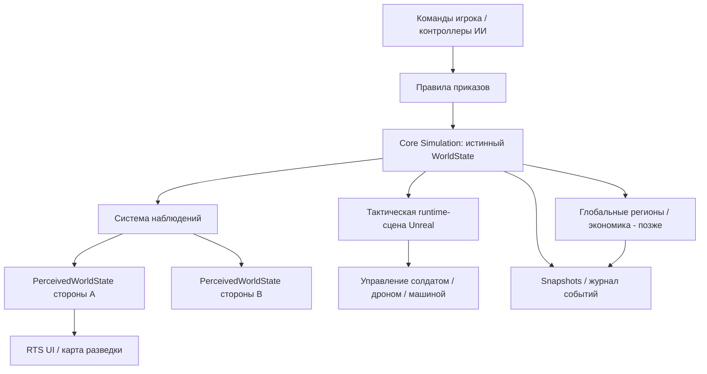

# Архитектура — версия 0.1 (проектная гипотеза)

**Статус:** концепция, не работающая реализация. Точный UE pin задаёт `FOC-001`.

## Одна симуляция, три представления



## Границы модулей

| Система | Ответственность | Не должна делать |
|---|---|---|
| Core Simulation (C++) | `UnitId`, ресурсы, приказы, наблюдения, события, сохранение state | Зависеть от UMG/камеры/материалов |
| Tactical Runtime (Unreal C++) | Активные Actors, AI, навигация, сенсоры, коллизии, взаимодействие | Рассылать клиенту скрытый true state |
| Presentation (Blueprints / UMG) | RTS-камера, HUD, индикаторы, анимации | Авторитетно менять ресурсы/позиции врага |
| Strategic Simulation (будущее) | Регионы, население, бюджет, промышленность, стратегический тик | Считать тысячи удалённых солдат Actor-ами |
| Platform Services (будущее) | Профили, онлайн, платежи, аналитика | Участвовать в балансе MVP |

## Первые доменные типы (псевдоконтракт)

```text
UnitId: stable unique identifier
UnitState: id, side, position, health, ammunition, fuel, order, alive
Order: id, unitId, kind (MOVE/HOLD/OBSERVE/RECON/ENGAGE/RESUPPLY), target, state
Observation: id, observerId, observedAt, sourceType, locationEstimate, uncertainty, possibleClass, confidence, status
WorldState: all authoritative units, terrain/state, resources, global time
PerceivedWorldState(side): only observations legally available to side
```

Полезная часть форматов — определение **семантики**, а не фиксация C++ API заранее. `confidence` относится к классификации/наличию наблюдаемого объекта, не к «вероятности победить». Устаревание задаётся игровыми правилами.

## Контракты и инварианты

1. Одно физическое подразделение имеет один стабильный ID в режиме RTS, прямом управлении, сохранении и (позже) глобальной кампании.
2. `Possess` передаёт контроль, а не пересоздаёт объект и не обнуляет текущий приказ без предусмотренного правила.
3. Мир продолжает тикать для прочих юнитов. В паузе одиночной кампании действуют отдельные правила времени.
4. Ресурсы ограничены: приход = расход + остаток (+ явно оформленные источники производства). Нельзя получать бесплатные боеприпасы/топливо от переключения масштаба.
5. Контакт разведки не равен реальному состоянию цели. Конфликтующие наблюдения разрешаются явно, не «магической» позицией.
6. Сетевой клиент не должен получать скрытые координаты вообще, не только скрывать их в UI.
7. Snapshot всегда имеет версию схемы. Несовместимая версия должна выдавать явную ошибку или применять проверенную миграцию.

## Модель обновления

Для MVP отделить фиксированный логический шаг симуляции от частоты рендера (число тиков выбрать после профилирования). ИИ и сенсоры не должны опрашивать все единицы каждый кадр без необходимости. Журнал событий должен содержать важные изменения ресурсов, перемещения и наблюдения, но не нужен полный event sourcing.

## Переход к большой кампании

Вход в бой: стратегический снимок резервирует конкретные `UnitId` и ресурсы. Во время боя остальные регионы развиваются упрощёнными шагами. Выход: в стратегическую систему возвращаются потери, повреждения, запасы и результат территории, без повторного создания исходной армии. **Пока не реализовано**; отдельные FOC-03x.

## Сеть, безопасность и честный PvP

Сначала одиночная симуляция с теми же интерфейсами доступа, чтобы не переписывать информацию с нуля. В будущем dedicated server — единственный источник истинных позиций и результатов. На клиента уходит отфильтрованное состояние: свои единицы и свои разведконтакты. Любой импорт данных клиента валидируется по правилам симуляции.

## Важные НЕ-решения

Не выбираем сейчас полноценный ECS, MassEntity, World Partition, GAS, микросервисы, базу данных для экономики, сложную баллистику и real-world sensor fidelity. Возвращаемся к ним только после измерений или появления реальной потребности.

## Минимальная реализация FOC-004

В существующем модуле FogOfCommand каталог Domain содержит Core-only значения
UnitId, SideId, OrderId и слот UnitState. [Контракт](UNIT_STATE.md) фиксирует
стабильную идентичность, здоровье/боезапас, атомарные отказы, terminal destruction
и version1 value snapshot. Слот не зависит от Actor, UObject, Tick, мира или UI;
копирование снимка не создаёт новую сущность, повторная инициализация не пополняет
ресурсы и не оживляет уничтоженный юнит.

Это состояние одного юнита. Глобальный WorldState/PerceivedWorldState, реестр
владельца, исполнение приказов, сохранения SaveGame и Actor-интеграция здесь не
реализованы. Узкая модель приказов FOC-005 описана отдельно ниже.
Проверки выполняются через [Automation gate](TESTING.md), фактические результаты —
в [очищенном отчёте FOC-004](diagnostics/FOC-004-windows-unit-state.md).

## Минимальная реализация FOC-005

[Доменный контракт MOVE/HOLD](ORDERS.md) задаёт intent, Pending/Executing и
терминальные Completed/Cancelled/Failed, тики симуляции и типизированные причины.
FUnitOrders владеет состоянием одного юнита и его локальной историей; наружу
доступны только const views. Назначение/снятие CurrentOrderId выполняется через
валидируемый compare/exchange, замена и уничтожение согласуют обе части состояния
без частичной мутации при отказе. Переключение контроллера не является операцией
этой модели и само по себе не сбрасывает приказы или ресурсы.

Модель не выполняет навигацию, AI, MOVE/HOLD в сцене, глобальный поиск UnitId,
сетевую дедупликацию или SaveGame. Complete лишь принимает результат внешнего
исполнителя. История хранится для идемпотентности в пределах одного владельца;
concurrency/eviction и последующие игровые системы не добавлены. Общий Windows
gate теперь включает прежние девять и восемь Orders-тестов; фактические результаты
приведены в [отчёте FOC-005](diagnostics/FOC-005-windows-orders.md).

## Минимальная реализация FOC-006

[Журнал событий](EVENT_LOG.md) принадлежит FUnitOrders: только принятые реальные
изменения записывают структурированные значения с simulation tick, sequence,
UnitId/OrderId и типизированными причинами. Ring хранит последние256 записей;
публичные чтения возвращают копии. Замена и уничтожение публикуют согласованный
batch после изменения состояния; отказ и no-op не изменяют журнал/время.
Обычные команды проверяют активный слот без полного сканирования истории;
Validate остаётся явным полным аудитом. Это диагностическое окно истинного
состояния, не event sourcing и не фильтрованное представление игрока.

Изолированные developer-команды по явному -FocEventDebug исключены из Shipping/Test;
они не меняют сцену, не исполняют MOVE и не создают кадровый Tick. Общий gate
теперь включает прежние17 и шесть Events-тестов; реальные Windows результаты
публикуются в [очищенном отчёте FOC-006](diagnostics/FOC-006-windows-event-log.md).
