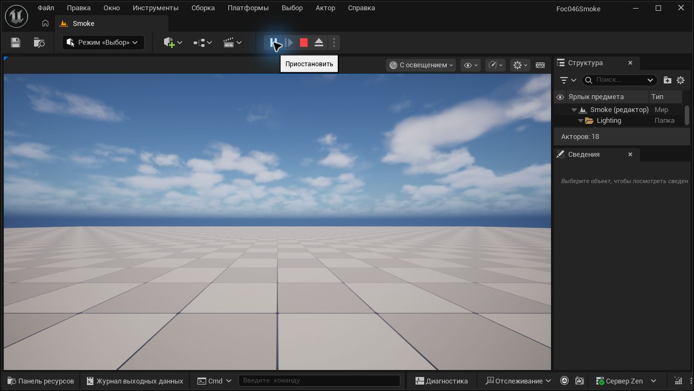

# FOC-046: Windows Blank C++ smoke

Дата: 2026-10-23, Europe/Moscow. Задачи: [#53](https://github.com/Hazernit/fog-of-command/issues/53), [#7](https://github.com/Hazernit/fog-of-command/issues/7).

Это поэтапный отчёт с реального Windows-ПК. Пока не выполнены build, Editor/PIE и GPU gate, конфигурация не принимается и Issues остаются открытыми. Движок в main по-прежнему TBD; кандидат PR #52 не равен принятому pin.

## Область и сохранность данных

- Проверяется одноразовый Blank C++ проект вне репозитория. FOC-002 не начинается, игровой `.uproject` не создаётся.
- MyProject не изменяется; пользовательские Editor/IDE не закрываются.
- Агент не запускает установщики/обновления движка, toolchain или драйвера и не меняет BIOS/сеть/защиту. Автоматические побочные действия первого запуска Editor описаны ниже отдельно.
- В Git публикуются только переносимая процедура и отредактированные результаты. Raw-логи, скриншоты с личными данными, абсолютные локальные пути, токены и машинные идентификаторы остаются вне Git.

## Этап 1: новая установка и toolchain

Актуальные `AGENTS.md`, `docs/CODEX_WORKFLOW.md`, #53 и #7 прочитаны из GitHub; исходный main: `c693048f687d6a32e77936cbab7d67db67a497ec`. Проверки выполняются локальными Windows-инструментами, а не симулируются по документации.

| Компонент | Фактическое наблюдение |
|---|---|
| Unreal Engine | **5.8.4**, CL **58902052**, compatible CL55116800, branch `++UE5+Release-5.8` |
| Источник версии | `Engine/Build/Build.version` и Epic Launcher manifest; incomplete=false |
| Build tools | InstalledBuild marker, Build.bat, UBT, Editor и Blank C++ template присутствуют |
| .NET UE | Bundled SDK **10.0.203**, runtime **10.0.7**; `dotnet --info` выполнен |
| Visual Studio | Build Tools2019 **16.11.60**; Community2022 **17.14.42**; Community2026 **18.10.4** |
| MSVC toolset directories | **14.29.30133**, **14.44.35207**, **14.51.36231** |
| cl.exe versions | **19.29.30159**, **19.44.35229**, **19.51.36260** |
| Windows SDK | **10.0.19041.0**, **10.0.22621.0**, **10.0.26100.0** |

Именно установленный UE5.8 использует `Engine/Config/Windows/Windows_SDK.json`: MSVC minimum14.38.33130, preferred families14.50.35717–14.50.99999 и14.44.35207–14.44.99999. Важно различать toolset directory и actual compiler version: установленный каталог14.44.35207 содержит cl19.44.35229/UBT-version14.44.35229, выше исключённого диапазона14.44.0–14.44.35210. Установленный14.51 новее preferred. SDK minimum10.0.19041.0, main10.0.22621.0; SDK26100 присутствует. Окончательные selected MSVC/SDK будут зафиксированы по UBT log, наличие компонентов не является PASS сборки.

Старый UE5.3.2/MSVC14.51 запуск ранее завершался C4668/C4067 на `__has_feature`. Это отдельный исторический результат; он не переносится на UE5.8.4.

## Текущие проверки

| Проверка | Статус | Доказательство / ограничение |
|---|---|---|
| Новая UE5.8.4 обнаружена | **PASS** | Два локальных источника версии и build tools |
| MSVC/SDK inventory | **PASS** | vswhere, executable/file versions, SDK headers/libs/tools |
| Clean project C++ build UE5.8.4 | **PASS** | Native exit **0**, wall time **93.037 с**, UBT **90.70 с** |
| Editor / C++ module load / DX12 | **PASS** функционально | DLL загружена, D3D12/SM5, RTX4070; startup automation errors учтены отдельно |
| 3 коротких цикла PIE | **PASS** | Три Play/Stop, Selected Viewport, карта `/Game/Smoke`, UI и runtime log |
| 30 минут PIE / повторное открытие | **NOT RUN** | Следующие этапы, пока не засчитываются |
| Встроенные startup automation checks | **FAIL** | 17 сообщений `Condition failed`, первопричина пока UNKNOWN |
| GPU telemetry/events и независимая нагрузка | **NOT RUN** | Нельзя заменить инвентаризацией драйвера |
| Приёмка версии владельцем | **NOT RUN** | #53/#7 не закрываются, PR остаётся Draft |

## Этап 2: выполненная чистая сборка

Прогон `FOC046-20261023-030650-3740b85d`: **03:06:50.593–03:08:23.633 +03:00**, 23.10.2026. Выполнен `scripts/windows/run_foc046_clean_smoke.ps1` с локальными EngineRoot/EvidenceRoot. Созданы шесть текстовых файлов нового проекта из установленного TP_Blank, сохранены BuildSettingsVersion.V7 и IncludeOrderVersion.Unreal5_8. Генерация проекта через Editor UI — **NOT RUN**.

`pre-build.json`: `BinariesExistedBeforeBuild=false`, `IntermediateExistedBeforeBuild=false`. UBT: `Creating makefile ... (no existing makefile)`. Созданы DLL модуля и target receipt. Native wrapper exit0, wall time93.037с; UBT90.70с, executor81.67с.

UBT автоматически выбрал **MSVC14.44.35229**, каталог toolset **14.44.35207** из VS2022 **17.14.42**, **SDK10.0.22621.0**, bundled.NET **10.0.203**. Флаг CompilerVersion не задавался. Повторная сборка с14.51 или принудительным14.44 — **NOT RUN**, поскольку текущий build уже PASS.

Очищенные строки UBT:

```text
Creating makefile for Foc046SmokeEditor (no existing makefile)
Using Visual Studio 14.44.35229 toolchain (<VS_ROOT>/VC/Tools/MSVC/14.44.35207) and Windows 10.0.22621.0 SDK (<WINDOWS_KITS_ROOT>).
Using Unreal Build Accelerator local executor to run 7 action(s)
[6/7] Link [x64] UnrealEditor-Foc046Smoke.dll
[7/7] WriteMetadata Foc046SmokeEditor.target [NoUba]
Result: Succeeded
Total execution time: 90.70 seconds
```

Это clean build нового проектного модуля на установленном binary Engine. UBA local cache и shared/engine caches не очищались; cold-cache performance или полная сборка Engine — **NOT RUN**. Raw UBT/trace/stdout и JSON результата остаются вне Git.

## Воспроизведение сборки

Переменные `UE_ROOT`, `SMOKE_PROJECT`, `SMOKE_EVIDENCE` обозначают локальные пути оператора; их значения не публикуются. Проект будет новым, из текстового `TP_Blank` установленного движка; до первой сборки `Binaries` и `Intermediate` должны отсутствовать. Это чистая сборка проектного модуля на установленном движке, не пересборка Engine и не очистка общих DDC.

```powershell
& (Join-Path $env:UE_ROOT 'Engine/Build/BatchFiles/Build.bat') `
  Foc046SmokeEditor Win64 Development "-Project=$env:SMOKE_PROJECT" `
  -WaitMutex -NoHotReloadFromIDE -NoHotReload -MaxParallelActions=4 `
  "-Log=$(Join-Path $env:SMOKE_EVIDENCE 'UnrealBuildTool.log')"
```

При FAIL сначала разбирать фактический UBT log. У скрипта есть опциональный CompilerVersion для явного выбора уже установленного компилятора; в успешном прогоне он не понадобился. Глобальный XML и исходники движка не изменялись. Ничего не устанавливать автоматически.

## Этап 3: Editor и короткие PIE циклы

Editor запущен отдельно на новом проекте с `-dx12 -log -abslog=<LOCAL_EDITOR_LOG>`; MyProject не открывался. В логе загружен `UnrealEditor-Foc046Smoke.dll`, `Engine is initialized`; engine initialization44.84с. Реально выбран **D3D12, SM5**, адаптер **RTX4070**, driver **617.42**. Максимальные возможности адаптера FL12_2/SM6.7 не означают использование SM6; SM6/Lumen/Nanite — **NOT RUN**.

Через реальный Windows UI создан новый **Basic** level, сохранён только во временном проекте как `/Game/Smoke`. Проверен режим **Selected Viewport**, затем выполнены три Play/Stop; лог содержит `Bringing World /Game/UEDPIE_0_Smoke.Smoke up for play` и `BeginTearingDown` для каждого:

| Цикл | Play / Stop, +03:00 | Результат |
|---|---|---|
| 1 | 03:14:35.690 / 03:14:44.659 | PASS |
| 2 | 03:14:53.704 / 03:15:22.190 | PASS |
| 3 | 03:15:38.205 / 03:16:02.932 | PASS |



Скриншот оригинальный, без генерации/изменения изображения; перед публикацией проверено отсутствие личных путей и других приложений. Первоначальный capture неактуального startup window дал ошибку Computer Use; после выбора текущего окна и foreground activation снимок Editor получен. Это ошибка UI observation, не доказательство сбоя UE.

В startup log есть **17 `LogAutomationTest: Error: Condition failed`**. Исходники установленного Engine подтверждают автоматический вызов `RunSmokeTests()` и generic `CHECK` без выражения в сообщении. Имена/итоги отдельных тестов при обычном уровне логирования не видны. Возможная связь с ru-RU и сравнениями локализованных сообщений с английскими литералами во встроенных UnifiedError tests остаётся **гипотезой**, точная атрибуция всех17 **UNKNOWN**. Эти ошибки не считать исправленными или безвредными. Функциональный Editor/PIE PASS не равен запуску без ошибок.

В проверенной части журнала отсутствовали fatal/assert/ensure, device removed/GPU crash и ошибки загрузки проектного модуля. Также есть сообщения об отсутствующих optional profiling DLLs и SDK других платформ; другие платформы — **NOT RUN**. При первом запуске Editor **автоматически скопировал/установил bundled Zen cache service из Engine в пользовательский cache**, записал его конфигурацию и сообщил миграцию default cache path. Это наблюдаемый побочный эффект штатного запуска Editor; отдельный installer или обновление агент не запускал. Сообщение о будущем удалении старой cache location не доказывает фактическое удаление — оно отдельно не проверялось.

GPU baseline до Editor: **02:54:05–03:09:05 +03:00** System log прочитан обычным пользователем вне sandbox; среди5событий0 совпадений Display/nvlddmkm/WHEA/Kernel-Power41/EventLog6008. `nvidia-smi` exit0:51°C, GPU5%, P8, VRAM1195/12282MiB. Это baseline, не оценка стабильности. OS build26300.9711/26H2 Professional; CPUi9-9900K, usableRAM63.85GiB. Повторный запрос физически установленной RAM недоступен в sandbox (**NOT RUN**, Access denied), это не отсутствие памяти.

## Переносимая процедура Editor/PIE/GPU

После exit0 открыть новый проект, используя только локальные значения переменных:

```powershell
& (Join-Path $env:UE_ROOT 'Engine/Binaries/Win64/UnrealEditor.exe') `
  $env:SMOKE_PROJECT /Engine/Maps/Entry -dx12 -log `
  "-abslog=$(Join-Path $env:SMOKE_EVIDENCE 'editor-dx12.log')"
```

1. Проверить именно Foc046Smoke в заголовке и загрузку модуля в log. **File → New Level → Basic**, затем **Save Current Level As → /Game/Smoke** только внутри временного проекта. Подождать завершения shader preparation.
2. В меню Play выбрать **Selected Viewport**, Play, а не Simulate/Standalone. Сделать три Play/Stop. Лог должен содержать world `/Game/UEDPIE_0_Smoke`, а не только запуск процесса Editor.
3. Включить ещё один непрерывный PIE минимум на1800с, записать реальное начало/конец. Для read-only telemetry использовать скрипт ниже, подставляя локальный PID тестового Editor:

```powershell
./scripts/windows/collect_foc046_gpu_telemetry.ps1 `
  -EditorProcessId $EditorProcessId `
  -EditorLog (Join-Path $env:SMOKE_EVIDENCE 'editor-dx12.log') `
  -EvidenceRoot $env:GPU_EVIDENCE_ROOT -DurationSeconds 1800 -IntervalSeconds 10
```

4. Сам collector не управляет PIE и не доказывает его активность; сопоставить UI, world start/teardown в log, фактические часы, интервалы телеметрии, ошибки доступа и System events. При артефактах, driver reset, fatal/device removed остановить runtime и сохранить доказательства. Kernel-Power41 сам по себе не устанавливает причину.
5. Остановить PIE, штатно закрыть только тестовый Editor, снова открыть этот проект с `/Game/Smoke` и новым `-abslog`, сделать Play/Stop и проверить второй log. Встроенным automation checks уделить отдельное внимание; при необходимости добавить процессный `-LogCmds="LogAutomationTest Log"` для имён тестов. Этот диагностический повтор пока **NOT RUN**.

Непрерывный прогон начат **03:17:02.993 +03:00**. Telemetry collector начал30минутный интервал в **03:18:47.890 +03:00**, поэтому runtime будет продолжен до завершения сбора. Это промежуточное состояние, завершённый30min gate пока **NOT RUN**.

`python scripts/validate_backlog.py` выполнен: **PASS**, `OK: 45 task issues, 6 epics, all dependencies and GDD files present`. PowerShell parser, проверки guards runner и `git diff --check` — **PASS**. Эти проверки не заменяют runtime. Raw-данные и абсолютные значения переменных не коммитятся.
