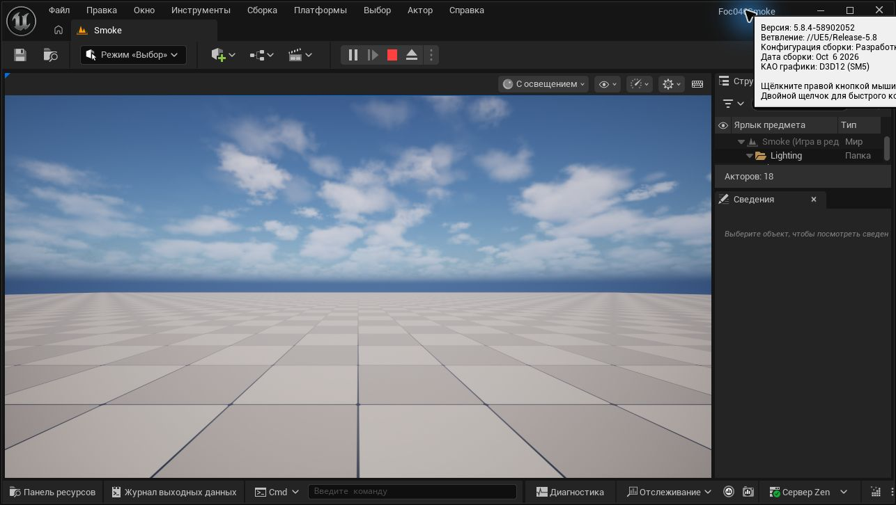
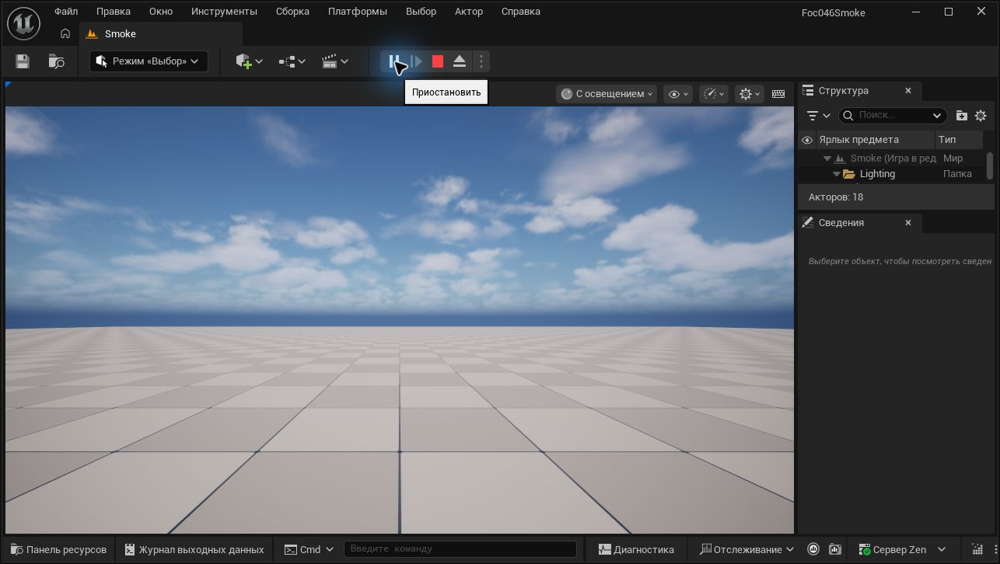
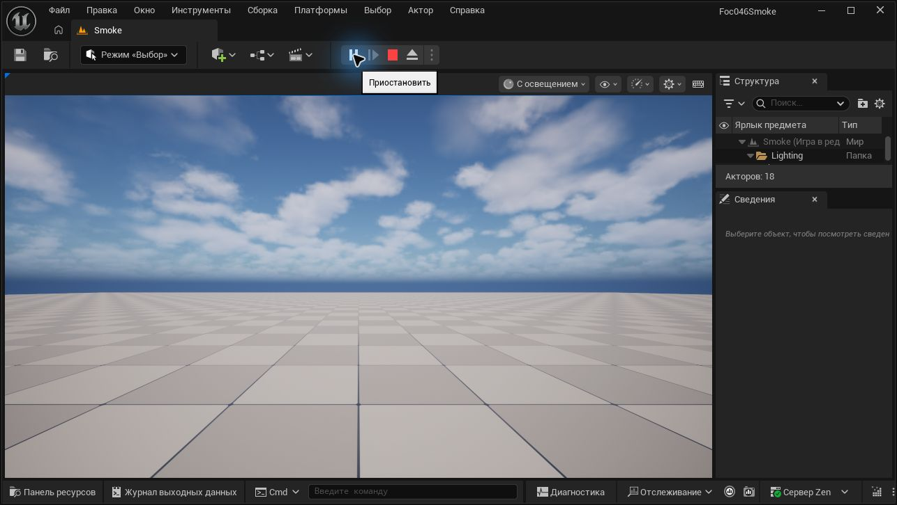

# FOC-046: Windows Blank C++ smoke

Прогоны: 2026-10-23 и повтор 2026-10-26, Europe/Moscow. Задачи: [#53](https://github.com/Hazernit/fog-of-command/issues/53), [#7](https://github.com/Hazernit/fog-of-command/issues/7).

## Повторная проверка 2026-10-26

По новому запросу владельца заново прочитаны GitHub `AGENTS.md`, `docs/CODEX_WORKFLOW.md`, #53 и состояние Draft PR #54. Инструкции совпадают с рабочей копией; ветка чистая на старте, исходный HEAD `adc55a6`. Используются та же issue-ветка и PR; результаты 23 октября ниже остаются историческим прогоном, а не подменяют текущие тесты.

Свежий inventory в 07:14–07:15 +03:00:

| Проверка | Результат 26 октября |
|---|---|
| UE / Launcher manifest / Build.version | **5.8.4 CL58902052**, compatible CL55116800, incomplete=false; версия и CL совпадают с 23 октября |
| Другие установки | В проверенных Epic manifests и известных install roots более новая версия не найдена; HKLM5.3/4.0 указывают отсутствующие каталоги |
| Пользовательские custom builds | **PASS**, в07:26:17 обычным пользователем вне sandbox проверено отсутствие HKCU custom Builds key; первоначальный sandbox access denied уточнён |
| Пробел обнаружения | Полный поиск по всем томам — **NOT RUN**; вывод ограничен проверенными manifests, registry и известными install roots |
| Engine tools/template | Editor, Editor-Cmd, Build/Clean/RunUAT, UBT, InstalledBuild и TP_Blank C++ source/rules присутствуют |
| Bundled .NET | **PASS**, SDK10.0.203 / runtime10.0.7 / MSBuild18.3.3 |
| UnrealBuildTool.dll metadata | FileVersion / ProductVersion / AssemblyVersion **5.8.0.0**, прочитаны из UBT этой установки UE5.8.4; номер assembly не подменяет Engine patch/CL |
| Visual Studio | Build Tools2019 **16.11.60**, Community2022 **17.14.42**, Community2026 **18.10.4** |
| MSVC actual / toolset directory | **14.29.30159 / 14.29.30133**, **14.44.35229 / 14.44.35207**, **14.51.36260 / 14.51.36231** |
| Windows SDK | **10.0.19041.0 / 10.0.22621.0 / 10.0.26100.0**: headers/libs/tools присутствуют |
| Windows / CPU / RAM | **26300.9711 / 26H2 Pro**, i9-9900K /16 logical; свежий запрос installed RAM **PASS:64GiB**, usable **63.85GiB** |
| GPU baseline | RTX4070 / driver **617.42**, query exit0, **50°C /9% /P8 /1220MiB из12282MiB /12.99W** |
| System baseline до Editor | **07:00:35.992–07:15:35.992**: read PASS,4 события;0 Display/nvlddmkm/WHEA/Kernel-Power41/EventLog6008;0 Critical/Error;1 Warning DistributedCOM10016 в07:12:08.159 |
| Новый clean build | **PASS**, native exit **0**, **87.041 с** wall / **84.31 с** UBT /53.54 с UBA |
| Editor / module / RHI | **PASS функционально**, initialization **63.20 с**, D3D12/SM5, RTX4070, driver617.42 |
| Три коротких PIE | **PASS**, Selected Viewport, сохранённая `/Game/Smoke`, UI+world start/teardown |
| Startup tests ru-RU | **FAIL:425/428 PASS,3 FAIL,17CHECK errors**, те же три named tests, что 23 октября |
| Непрерывный PIE | **PASS**,07:21:01.213–07:51:32.052, **1830.839 с (30мин30.839с)** |
| GPU telemetry | **PASS как наблюдение этой сцены**,1800.014с,178проб,43–49°C;0query/process-access/nonresponding/GPUfatal ошибок,0выбранных System events |
| Reopen / PIE | **PASS**, initialization17.17с, Play07:53:21.414 /Stop07:53:36.565 |
| EN process comparison | **PASS:428/428 startup tests**,0ошибок уровня Error, initialization19.33с; проверенные сохранённые language/culture preferences не изменились |

Desktop C++ присутствует, NativeGame workload и Unreal IDE packages не зарегистрированы. Фактическому CLI build доступных компонентов хватило; недостающих обязательных компонентов этого сценария не выявлено. Baseline DCOM warning предшествует Editor, причинная связь с GPU не установлена. Установки/настройки агентом не менялись, MyProject не открывался; raw evidence остаётся вне Git.

Новый run `FOC046-20261026-071506-7a66942d`: **07:15:06.399–07:16:33.443 +03:00**. Runner создал новый временный проект вне Git из шести текстовых TP_Blank файлов; до сборки `Binaries=false`, `Intermediate=false`, makefile отсутствовал. **Автоматический UBT выбор: VS2022 17.14.42, MSVC14.44.35229, SDK10.0.22621.0**, bundled.NET10.0.203; CompilerVersion не задавался. Выполнены7 compile/link/receipt actions, создан `UnrealEditor-Foc046Smoke.dll`. Результат: `Succeeded`, native exit0. Полная сборка Engine/cold caches — **NOT RUN**, общие caches не очищались.

Команды runner, build, Editor и telemetry в переносимой процедуре ниже применимы к этому новому проекту; значения локальных переменных и raw JSON/логи в Git не включаются.

Editor26.10 загрузил новый `UnrealEditor-Foc046Smoke.dll`, инициализация завершена **07:18:13.224**. Через Windows UI создан Basic level и сохранён `/Game/Smoke` только в новом временном проекте; shader preparation завершена перед PIE. Три коротких Play/Stop по runtime log, +03:00:

| Цикл | Play | Stop |
|---|---|---|
| 1 | 07:20:00.250 | 07:20:15.473 |
| 2 | 07:20:19.956 | 07:20:32.333 |
| 3 | 07:20:37.264 | 07:20:53.934 |

Отдельный непрерывный PIE начат **07:21:01.213**, UI snapshot07:21:34 показывает активный PIE/18actors. Read-only GPU collector запущен после старта игры на1800с; сам exit0 collector не будет засчитан как доказательство PIE.

`nvidia-smi` измеряет весь GPU. Пользовательские приложения не закрывались, их фоновая нагрузка не контролируется; всю загрузку адаптера приписывать Editor нельзя. Это периодические аппаратные измерения плюс выборочные UI-наблюдения, не непрерывная видеозапись и не независимый stress test.

Checkpoint **07:26:18 +03:00**: UI в07:25:42 подтверждает активный PIE и обновившееся небо; log содержит4world starts/3teardowns, последний PIE продолжается. **31 проба**, последняя elapsed303.644с: GPU45°C/39%, EditorResponding=true;0query/process-access/nonresponding errors,0новыхfatal/GPU совпадений. Это промежуточное наблюдение, не завершённый30min PASS.

Checkpoint **07:36:10 +03:00**: после15минут непрерывного PIE новое UI-наблюдение подтверждает активную игру/18actors и обновившуюся сцену. **90 проб**, последняя elapsed900.565с: GPU44°C/39%, EditorResponding=true; query/process-access/nonresponding errors и новыеfatal/GPU совпадения —0. Полный30min gate ещё **NOT RUN как завершённая проверка**.

Итог26.10: непрерывный PIE завершён штатной кнопкой Stop **07:51:32.052**; runtime world start/teardown дают **1830.839с**, UI перед Stop подтверждает активный PIE/18actors, после Stop — Editor/8actors. Выборочные снимки около5/10/15/20/24/29/30минут подтверждали обновляющуюся сцену без наблюдаемых артефактов. Только тестовый Editor штатно закрыт в07:51:50, его процесс завершился до повторного открытия.

Collector exit0: **07:21:05.883–07:51:05.898**, elapsed **1800.014с**,178CSV rows, последняя проба elapsed **1790.911с**.0query/process-access/nonresponding ошибок;178успешных приращений log,0resets/read errors/newfatal-GPU matches. SystemBefore и SystemDuring read PASS,0выбранных Display/nvlddmkm/WHEA/Kernel-Power41/EventLog6008 событий. Pre-collection окно включает более раннюю работу Editor/короткие PIE и не приписывается последующей нагрузке.

Независимая проверка CSV подтвердила178последовательных samples и совпадение с embedded NVIDIA output. Интервалы10.092–10.254с; интервалов >15с нет. Последние9.103с до окончания collector не содержат отдельного sample; это ограничение периодики, а не непрерывное измерение.

| GPU26.10 | Минимум–максимум |
|---|---|
| Температура | **43–49°C** |
| Загрузка | **36–42%** |
| VRAM used | **2038–2067MiB** |
| Power draw | **57.45–71.76W** |





Подробный текущий RU log подтверждает425PASS/3FAIL: `FUnifiedErrorTest_CreateErrorMessage`7CHECK, `FUnifiedErrorTest_CreateErrorMessageWithContext`4CHECK, `FStructuredLogFormatTest`6CHECK. В прочитанном startup-снимке0fatal/assert/ensure/device-removed/GPU-crash совпадений;17 ошибок уровня Error относятся к startup automation. Отдельное Warning DirectoryWatcher об отсутствовавшем Content нового проекта не является GPU-сбоем.

Автоматические действия Editor26.10: уже установленный bundled Zen признан актуальным, запущен локальный ZenServer; журнал также сообщает обновление несовместимого layout key. При reopen журнал сообщает автоматическую очистку одного orphaned AssetRegistry cache binary. Поэтому неизменность вообще всех глобальных Editor/cache files не заявляется. Агент установщики, исходники движка, driver/BIOS/сеть/защиту не менял; ручного удаления caches не выполнял.

После подтверждённого выхода первого Editor тот же собранный проект и `/Game/Smoke` повторно открыты с теми же DX12/log аргументами. Модуль и RHI загружены, initialization17.17с. Play07:53:21.414 /Stop07:53:36.565 — **PASS**; затем штатное закрытие07:53:44. RU reopen повторил **425PASS/3FAIL,17CHECK errors** у тех же трёх тестов.

Третий процесс добавил только диагностический `-culture=en` (и отдельное имя log). Runtime log подтверждает language/locale override=en и **428/428PASS**,0ошибок уровня Error,0fatal/assert/ensure/device-removed/GPU-crash совпадений. Модуль и D3D12/SM5/RTX4070 подтверждены, initialization19.33с. PIE в дополнительном EN-процессе — **NOT RUN**; функциональный runtime проверен в RU. EN Editor штатно закрыт **07:54:55**, все три тестовых процесса завершены по проверке07:54:56.

Свежий RU/EN результат подтверждает culture-зависимость наблюдаемых startup failures на той же установленной версии. Это диагностическое сравнение, не исправление RU baseline: его3FAIL остаются в результате. Снимки сохранённых language/culture preferences **07:22:04.742 /07:55:32.322**:0keys до/после, canonical SHA256 совпадает. Финальный scan26INI candidates/13existing учитывает новые INI и те же global/Common/project roots; проверены Culture/Language/Locale/PreviewGameLanguage/AssetGroupCultures. Вывод относится только к этим предпочтениям, не ко всем Editor files.

Заключительный System query после закрытия всех тестовых Editor: **07:15:35.992–07:55:32.401 +03:00**, read PASS,2события,0целевых GPU/WHEA/Kernel-Power41/EventLog6008 и **0Critical/Error/Warning**. Оба события — Information WindowsUpdateClient43×1 и19×1; это фоновая история Windows, не запущенные агентом updates. Baseline DCOM10016Warning в07:12 предшествует этому окну. Последний `nvidia-smi`07:55:32.729:exit0,53°C,GPU36%,P5,1291/12282MiB,19.16W. Это наблюдение после закрытия тестовых Editor, не утверждение о простое GPU.

**NOT RUN для26.10:** независимый тяжёлый GPU stress/общая сертификация стабильности/причины прошлых сбоев,SM6/Lumen/Nanite,Engine rebuild,cold-cache performance,другие MSVC/platform targets,Unreal IDE integration,полный hash audit MyProject,приёмка pin владельцем. Локальный backlog validator и PowerShell parser/guards — PASS; GitHub Actions **NOT RUN** по paths существующего workflow. MyProject не открывался/не редактировался,FOC-002 не начиналась,main не менялся; #53/#7 остаются открытыми, PR54 Draft.

## Предыдущий завершённый прогон 2026-10-23

Итог реальной проверки Windows: clean C++ build **PASS**, Editor/PIE, включая непрерывные **32мин21.549с** и повторное открытие, **PASS**; GPU smoke в этой сцене **PASS как наблюдение**. Встроенные startup tests при стандартной ru-RU: **425/428 PASS, 3 FAIL**; при процессном `-culture=en`: **428/428 PASS**. Это диагностическое сравнение, а не исправление установленного Engine. Issues остаются открытыми, [PR #54](https://github.com/Hazernit/fog-of-command/pull/54) — Draft. Принятие pin владельцем — **NOT RUN**; движок в main по-прежнему TBD, кандидат PR #52 не равен принятому pin.

## Область и сохранность данных

- Проверяется одноразовый Blank C++ проект вне репозитория. FOC-002 не начинается, игровой `.uproject` не создаётся.
- MyProject агентом не открывался и не редактировался; закрывались только запущенные для проверки Editor временного проекта. Полная проверка всех файлов MyProject по хешам — **NOT RUN**.
- Агент не запускает установщики/обновления движка, toolchain или драйвера и не меняет BIOS/сеть/защиту. Автоматические побочные действия первого запуска Editor описаны ниже отдельно.
- В Git публикуются только переносимая процедура и отредактированные результаты. Raw-логи, скриншоты с личными данными, абсолютные локальные пути, токены и машинные идентификаторы остаются вне Git.

## Этап 1: новая установка и toolchain

Актуальные `AGENTS.md`, `docs/CODEX_WORKFLOW.md`, #53 и #7 прочитаны из GitHub; исходный main: `c693048f687d6a32e77936cbab7d67db67a497ec`. Проверки выполняются локальными Windows-инструментами, а не симулируются по документации.

| Компонент | Фактическое наблюдение |
|---|---|
| Unreal Engine | **5.8.4**, CL **58902052**, compatible CL55116800, branch `++UE5+Release-5.8` |
| Источник версии | `Engine/Build/Build.version` и Epic Launcher manifest; incomplete=false |
| Build tools | InstalledBuild marker, Build.bat, UBT, Editor и Blank C++ template присутствуют |
| .NET UE | Bundled SDK **10.0.203**, runtime **10.0.7**; `dotnet --info` выполнен |
| Visual Studio | Build Tools2019 **16.11.60**; Community2022 **17.14.42**; Community2026 **18.10.4** |
| MSVC toolset directories | **14.29.30133**, **14.44.35207**, **14.51.36231** |
| cl.exe versions | **19.29.30159**, **19.44.35229**, **19.51.36260** |
| Windows SDK | **10.0.19041.0**, **10.0.22621.0**, **10.0.26100.0** |

Именно установленный UE5.8 использует `Engine/Config/Windows/Windows_SDK.json`: MSVC minimum14.38.33130, preferred families14.50.35717–14.50.99999 и14.44.35207–14.44.99999. Важно различать toolset directory и actual compiler version: установленный каталог14.44.35207 содержит cl19.44.35229/UBT-version14.44.35229, выше исключённого диапазона14.44.0–14.44.35210. Установленный14.51 новее preferred. SDK minimum10.0.19041.0, main10.0.22621.0; SDK26100 присутствует. Фактический UBT выбор и результат сборки приведены ниже.

Desktop C++ workload установлен. NativeGame/GameDevelopment workload и Unreal IDE integration не зарегистрированы в проверенных VS instances. Их отсутствие не заблокировало фактический CLI build; для выполненного сценария отсутствующих обязательных компонентов не обнаружено. IDE-интеграция Unreal — **NOT RUN**, установка дополнительных компонентов не потребовалась.

Старый UE5.3.2/MSVC14.51 запуск ранее завершался C4668/C4067 на `__has_feature`. Это отдельный исторический результат; он не переносится на UE5.8.4.

## Текущие проверки

| Проверка | Статус | Доказательство / ограничение |
|---|---|---|
| Новая UE5.8.4 обнаружена | **PASS** | Два локальных источника версии и build tools |
| MSVC/SDK inventory | **PASS** | vswhere, executable/file versions, SDK headers/libs/tools |
| Clean project C++ build UE5.8.4 | **PASS** | Native exit **0**, wall time **93.037 с**, UBT **90.70 с** |
| Editor / C++ module load / DX12 | **PASS** функционально | DLL загружена, D3D12/SM5, RTX4070; startup automation errors учтены отдельно |
| 3 коротких цикла PIE | **PASS** | Три Play/Stop, Selected Viewport, карта `/Game/Smoke`, UI и runtime log |
| Непрерывный PIE минимум30минут | **PASS** | 03:17:02.648–03:49:24.197, **1941.549с**; UI, world start/teardown и telemetry |
| Повторное открытие / PIE | **PASS** | Штатное закрытие, reopen той же карты; PIE03:51:24.925–03:51:37.865 |
| Встроенные startup automation checks | **RU FAIL / EN PASS** | ru-RU: 425/428 PASS, 3 FAIL, 17 `Condition failed`; `-culture=en`: 428/428 PASS |
| GPU telemetry / System events во время PIE | **PASS** как наблюдение | 1800.002с,178проб,49–51°C,0новых GPU/fatal строк,0выбранных событий |
| Независимая GPU-нагрузка / общая стабильность драйвера | **NOT RUN** | Результат ограничен этой базовой DX12-сценой |
| Приёмка версии владельцем | **NOT RUN** | #53/#7 не закрываются, PR остаётся Draft |

## Этап 2: выполненная чистая сборка

Прогон `FOC046-20261023-030650-3740b85d`: **03:06:50.593–03:08:23.633 +03:00**, 23.10.2026. Выполнен `scripts/windows/run_foc046_clean_smoke.ps1` с локальными EngineRoot/EvidenceRoot. Созданы шесть текстовых файлов нового проекта из установленного TP_Blank, сохранены BuildSettingsVersion.V7 и IncludeOrderVersion.Unreal5_8. Генерация проекта через Editor UI — **NOT RUN**.

`pre-build.json`: `BinariesExistedBeforeBuild=false`, `IntermediateExistedBeforeBuild=false`. UBT: `Creating makefile ... (no existing makefile)`. Созданы DLL модуля и target receipt. Native wrapper exit0, wall time93.037с; UBT90.70с, executor81.67с.

UBT автоматически выбрал **MSVC14.44.35229**, каталог toolset **14.44.35207** из VS2022 **17.14.42**, **SDK10.0.22621.0**, bundled.NET **10.0.203**. Флаг CompilerVersion не задавался. Повторная сборка с14.51 или принудительным14.44 — **NOT RUN**, поскольку текущий build уже PASS.

Очищенные строки UBT:

```text
Creating makefile for Foc046SmokeEditor (no existing makefile)
Using Visual Studio 14.44.35229 toolchain (<VS_ROOT>/VC/Tools/MSVC/14.44.35207) and Windows 10.0.22621.0 SDK (<WINDOWS_KITS_ROOT>).
Using Unreal Build Accelerator local executor to run 7 action(s)
[6/7] Link [x64] UnrealEditor-Foc046Smoke.dll
[7/7] WriteMetadata Foc046SmokeEditor.target [NoUba]
Result: Succeeded
Total execution time: 90.70 seconds
```

Это clean build нового проектного модуля на установленном binary Engine. UBA local cache и shared/engine caches не очищались; cold-cache performance или полная сборка Engine — **NOT RUN**. Raw UBT/trace/stdout и JSON результата остаются вне Git.

## Воспроизведение сборки

Переменные `UE_ROOT`, `SMOKE_PROJECT`, `SMOKE_EVIDENCE` обозначают локальные пути оператора; их значения не публикуются. Проект будет новым, из текстового `TP_Blank` установленного движка; до первой сборки `Binaries` и `Intermediate` должны отсутствовать. Это чистая сборка проектного модуля на установленном движке, не пересборка Engine и не очистка общих DDC.

Из корня рабочей ветки выполнить runner, указав локальную папку evidence вне Git; он сам создаст новый проект во временном каталоге и выполнит build:

```powershell
./scripts/windows/run_foc046_clean_smoke.ps1 `
  -EngineRoot $env:UE_ROOT -EvidenceRoot $env:SMOKE_EVIDENCE_ROOT
```

Из итогового локального JSON взять `Project` и `EvidenceDirectory` как значения `SMOKE_PROJECT` и `SMOKE_EVIDENCE` для следующих шагов. Не публиковать этот JSON без очистки. Для явного размещения нового проекта у runner есть `-WorkspaceRoot` (папка должна ещё не существовать). Фактический build вызов runner:

```powershell
& (Join-Path $env:UE_ROOT 'Engine/Build/BatchFiles/Build.bat') `
  Foc046SmokeEditor Win64 Development "-Project=$env:SMOKE_PROJECT" `
  -WaitMutex -NoHotReloadFromIDE -NoHotReload -MaxParallelActions=4 `
  "-Log=$(Join-Path $env:SMOKE_EVIDENCE 'UnrealBuildTool.log')"
```

При FAIL сначала разбирать фактический UBT log. У скрипта есть опциональный CompilerVersion для явного выбора уже установленного компилятора; в успешном прогоне он не понадобился. Глобальный XML и исходники движка не изменялись. Ничего не устанавливать автоматически.

## Этап 3: Editor и короткие PIE циклы

Editor запущен отдельно на новом проекте с `-dx12 -log -abslog=<LOCAL_EDITOR_LOG>`; MyProject не открывался. В логе загружен `UnrealEditor-Foc046Smoke.dll`, `Engine is initialized`; engine initialization44.84с. Реально выбран **D3D12, SM5**, адаптер **RTX4070**, driver **617.42**. Максимальные возможности адаптера FL12_2/SM6.7 не означают использование SM6; SM6/Lumen/Nanite — **NOT RUN**.

Через реальный Windows UI создан новый **Basic** level, сохранён только во временном проекте как `/Game/Smoke`. Проверен режим **Selected Viewport**, затем выполнены три Play/Stop; лог содержит `Bringing World /Game/UEDPIE_0_Smoke.Smoke up for play` и `BeginTearingDown` для каждого:

| Цикл | Play / Stop, +03:00 | Результат |
|---|---|---|
| 1 | 03:14:35.690 / 03:14:44.659 | PASS |
| 2 | 03:14:53.704 / 03:15:22.190 | PASS |
| 3 | 03:15:38.205 / 03:16:02.932 | PASS |


Скриншот оригинальный, без генерации/изменения изображения; перед публикацией проверено отсутствие личных путей и других приложений. Первоначальный capture неактуального startup window дал ошибку Computer Use; после выбора текущего окна и foreground activation снимок Editor получен. Это ошибка UI observation, не доказательство сбоя UE.

В первом startup log есть **17 `LogAutomationTest: Error: Condition failed`**. Исходники установленного Engine подтверждают автоматический вызов `RunSmokeTests()` и generic `CHECK` без выражения в сообщении. При обычном уровне логирования имена тестов не видны; поэтому первоначальная атрибуция была UNKNOWN. Выполненное ниже сравнение RU/EN уточнило все 17 ошибок и зависимость от culture. Функциональный Editor/PIE PASS не равен RU-запуску без ошибок.

В проверенной части журнала отсутствовали fatal/assert/ensure, device removed/GPU crash и ошибки загрузки проектного модуля. Также есть сообщения об отсутствующих optional profiling DLLs и SDK других платформ; другие платформы — **NOT RUN**. При первом запуске Editor **автоматически скопировал/установил bundled Zen cache service из Engine в пользовательский cache**, записал его конфигурацию и сообщил миграцию default cache path. Это наблюдаемый побочный эффект штатного запуска Editor; отдельный installer или обновление агент не запускал. Сообщение о будущем удалении старой cache location не доказывает фактическое удаление — оно отдельно не проверялось.

GPU baseline до Editor: **02:54:05–03:09:05 +03:00** System log прочитан обычным пользователем вне sandbox; среди5событий0 совпадений Display/nvlddmkm/WHEA/Kernel-Power41/EventLog6008. `nvidia-smi` exit0:51°C, GPU5%, P8, VRAM1195/12282MiB. Это baseline, не оценка стабильности. OS build26300.9711/26H2 Professional; CPUi9-9900K, usableRAM63.85GiB. Повторный запрос физически установленной RAM недоступен в sandbox (**NOT RUN**, Access denied), это не отсутствие памяти.

## Переносимая процедура Editor/PIE/GPU

После exit0 открыть новый проект, используя только локальные значения переменных:

```powershell
& (Join-Path $env:UE_ROOT 'Engine/Binaries/Win64/UnrealEditor.exe') `
  $env:SMOKE_PROJECT /Engine/Maps/Entry -dx12 -log `
  "-abslog=$(Join-Path $env:SMOKE_EVIDENCE 'editor-dx12.log')"
```

1. Проверить именно Foc046Smoke в заголовке и загрузку модуля в log. **File → New Level → Basic**, затем **Save Current Level As → /Game/Smoke** только внутри временного проекта. Подождать завершения shader preparation.
2. В меню Play выбрать **Selected Viewport**, Play, а не Simulate/Standalone. Сделать три Play/Stop. Лог должен содержать world `/Game/UEDPIE_0_Smoke`, а не только запуск процесса Editor.
3. Включить ещё один непрерывный PIE минимум на1800с, записать реальное начало/конец. Для read-only telemetry использовать скрипт ниже, подставляя локальный PID тестового Editor:

```powershell
./scripts/windows/collect_foc046_gpu_telemetry.ps1 `
  -EditorProcessId $EditorProcessId `
  -EditorLog (Join-Path $env:SMOKE_EVIDENCE 'editor-dx12.log') `
  -EvidenceRoot $env:GPU_EVIDENCE_ROOT -DurationSeconds 1800 -IntervalSeconds 10
```

4. Сам collector не управляет PIE и не доказывает его активность; сопоставить UI, world start/teardown в log, фактические часы, интервалы телеметрии, ошибки доступа и System events. При артефактах, driver reset, fatal/device removed остановить runtime и сохранить доказательства. Kernel-Power41 сам по себе не устанавливает причину.
5. Остановить PIE, штатно закрыть только тестовый Editor, снова открыть этот проект с `/Game/Smoke` и новым `-abslog`, сделать Play/Stop и проверить второй log. Встроенным automation checks уделить отдельное внимание; процессный `-LogCmds="LogAutomationTest Log"` использован для имён тестов в выполненном повторе.

Непрерывный прогон фактически выполнен **03:17:02.648–03:49:24.197 +03:00**, **1941.549с (32мин21.549с)** по world start/teardown. UI-наблюдение старта03:17:02.993 и последующие снимки подтверждают PIE; завершение выполнено штатной кнопкой Stop после полного telemetry интервала. Повторная проверка перед Stop показала активную игру,18actors и обновившееся небо; после Stop Editor вернулся к8actors.

Промежуточный checkpoint **03:32:18 +03:00**: примерно15минут непрерывного PIE; повторный снимок окна подтверждает активную игру и обновившуюся сцену. Собрана81проба telemetry, последняя50°C/GPU40%, EditorResponding=true,0ошибок опроса и0новых GPU/fatal совпадений. Сам checkpoint ещё не завершал30min gate; итог полного интервала приведён далее.



Read-only collector завершился exit0: **03:18:47.890–03:48:47.892**, **1800.002с**,178проб, последняя на1792.391с. Ни ошибок запроса GPU/доступа к процессу, ни non-responding проб. Интервал между пробами включает время запросов; это периодическое измерение и выборочная визуальная проверка, а не непрерывная видеозапись.

| GPU наблюдение | Минимум–максимум |
|---|---|
| Температура | **49–51°C** |
| Загрузка | **37–43%** |
| VRAM used | **2257–2277MiB** |
| Power draw | **67.67–78.53W** |

Скан178приращений Editor log: **0** новых fatal/device-removed/GPU-error совпадений,0ошибок чтения/сбросов log. System log доступен: за pre-collection и collection интервалы **0** Display/nvlddmkm/WHEA/Kernel-Power41/EventLog6008 совпадений. Pre-collection окно может содержать ранее запущенный Editor/короткие PIE; оно не приписывается последующей нагрузке. Startup17automation ошибок RU остаются отдельным FAIL и не маскируются этой GPU-сводкой.

После закрытия всех тестовых Editor повторно прочитан System за **03:09:00–03:54:14.289 +03:00**: 4 события, **0** выбранных GPU/hardware/unclean-shutdown событий, **0 Critical/Error/Warning**. Остальные — Information: Kernel-Power566×1 и Time-Service158×3; Kernel-Power566 не равен41. Последний `nvidia-smi` в03:54:14.635: exit0,53°C,GPU30%,P5,VRAM1485/12282MiB,19.23W. Это наблюдение после закрытия тестовых Editor, а не утверждение о простое всей системы.

Это подтверждает отсутствие наблюдаемого сбоя в данном сценарии. Независимая тяжёлая GPU-нагрузка, общая сертификация стабильности ПК/драйвера и причинная диагностика прежних сбоев — **NOT RUN**. Driver/BIOS/частоты не менялись; аппаратный blocker без наблюдаемого сбоя не создавался.

`python scripts/validate_backlog.py` выполнен: **PASS**, `OK: 45 task issues, 6 epics, all dependencies and GDD files present`. PowerShell parser, проверки guards runner и `git diff --check` — **PASS**. Эти проверки не заменяют runtime. Raw-данные и абсолютные значения переменных не коммитятся.

## Повторное открытие и уточнение startup errors

Первый Editor закрыт штатным CloseEditor, журнал содержит `Preparing to exit`. Тот же собранный проект и сохранённая `/Game/Smoke` повторно открыты с `-dx12 -log -LogCmds="LogAutomationTest Log"`, отдельный log. Модуль загружен, Engine initialized, DX12/SM5/RTX4070 подтверждены; Play03:51:24.925, Stop03:51:37.865 — **PASS**. Это повтор без пересборки или изменения исходников.

Подробный RU-log установил точную атрибуцию всех17ошибок:

| Встроенный тест Engine | RU-result | Condition failed |
|---|---|---|
| `FUnifiedErrorTest_CreateErrorMessage` | FAIL | 7 |
| `FUnifiedErrorTest_CreateErrorMessageWithContext` | FAIL | 4 |
| `FStructuredLogFormatTest` | FAIL | 6 |

Всего в RU-повторе **428 named tests: 425 PASS, 3 FAIL**. `StructuredLogSmoke` и остальные UnifiedError tests — PASS. Проверенные исходники содержат сравнения локализованных `LOCTEXT` сообщений с английскими ожиданиями. Конкретные значения всех провалившихся CHECK не выводятся, поэтому точное различие каждого значения — **NOT RUN**.

Затем RU Editor штатно закрыт. Тот же проект, карта, DX12 и подробный log повторены с единственным дополнительным диагностическим параметром **`-culture=en`**. В журнале подтверждены process overrides language/locale en: **428/428 named tests PASS**, в том числе все три теста из таблицы; **0 automation errors, 0 строк Error:, 0 fatal/GPU совпадений**. Модуль, Engine initialization и DX12/RTX4070 подтверждены; PIE в этом дополнительном EN-запуске — **NOT RUN** (runtime уже проверен в RU). Editor закрыт штатно в03:53:13, тестовые Editor завершены.

Сравнение подтверждает зависимость startup failures от culture в проверенной конфигурации. Это не изменение исходников/установленного движка и не доказательство исправления RU baseline; его **3 FAIL сохраняются в результате**.

Снимки language/culture preferences до и после сравнения охватывают global UE5.8 Saved Config, Common Saved Config и Config/Saved Config временного проекта: **0 сохранённых Culture/Language/Locale/PreviewGameLanguage/AssetGroupCultures keys до и после**, состояние этих предпочтений совпадает. После запуска учтены и вновь созданные INI. Это не утверждение о неизменности всех Editor/cache файлов; raw snapshots остаются локально.

Переносимый повтор сравнения после штатного закрытия предыдущего тестового Editor (карта уже сохранена):

```powershell
# RU baseline: те же аргументы, но без -culture=en; отдельное имя log.
& (Join-Path $env:UE_ROOT 'Engine/Binaries/Win64/UnrealEditor.exe') `
  $env:SMOKE_PROJECT /Game/Smoke -dx12 -log `
  '-LogCmds=LogAutomationTest Log' -culture=en `
  "-abslog=$(Join-Path $env:SMOKE_EVIDENCE 'editor-culture-en.log')"
```

## Итог и оставшиеся ограничения

Для фактически выбранных **UE5.8.4 / VS2022 / MSVC14.44.35229 / SDK10.0.22621.0** создание и чистая сборка нового C++ модуля, Editor, короткие и длительный PIE, reopen и GPU smoke выполнены. Установочные исправления не понадобились; автоматический Zen side effect описан выше. Отдельный дефект/ограничение — 3 RU startup self-tests при успешном EN-сравнении — оставлен для ревью.

**NOT RUN:** независимый тяжёлый GPU stress, общая сертификация стабильности ПК/драйвера, диагностика причин прошлых сбоев, SM6/Lumen/Nanite, сборка самого Engine, cold-cache performance, другие MSVC/platform targets, Unreal IDE integration, полный hash audit MyProject и принятие pin владельцем. GitHub Actions — **NOT RUN**: изменённые docs и Windows scripts не входят в `paths` существующего workflow `repo-checks.yml`; локальный backlog validator выполнен отдельно и прошёл.

Ни main, ни MyProject агентом не редактировались; FOC-002 не начиналась. #53/#7 остаются открытыми, PR #54 остаётся Draft для решения владельца о pin и RU startup errors.
